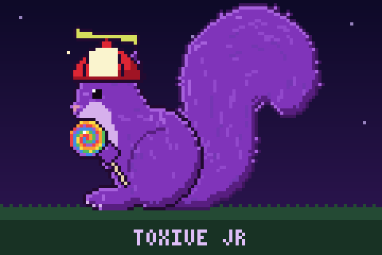

This bot will do several functions that Toxive would normally.

Functionality:
It will send "The night is young" and a Batman gif when certain words are mentioned.

It will send a no league gif when the word "league" is mentioned.

It will send a no valorant gif when the word "val" or "valorant" is mentioned

It will send a "nah I'd win gif" when "jjk" or "jijutsu kaisen" is mentioned

It will send a "ready to comply" when Junior is mentioned.

It talks like Toxive (a small model fine-tuned on Toxive's messages) when @mentioned, replied to, or called "junior", and very occasionally on its own.

A purple squirrel in a propeller hat lives on the Pi's screen:



# This has no practical use.

---

## Keyword replies

All keyword replies live in [replies.yaml](replies.yaml). Edit it and the bot picks up changes on the next message, no restart. The top of the file explains every option.

Or from Discord (owner only, set in [settings.py](settings.py)):

| Command | What it does |
|---|---|
| `!addreply valorant, val \| https://tenor.com/...` | Reply with text/gif when any of those words appear. Phrases with spaces match anywhere. |
| `!addreply bocchi` + attach an image | Reply with that image (saved to `media/`) |
| `!delreply <name>` / `!replies` / `!reload` | Remove, list, reload |
| `!shutup` / `!talk` | Turn unprompted AI replies off / on |

## AI replies

The AI only replies when someone @mentions Toxive Jr, replies to one of its messages, or says "junior", and otherwise has a 2% chance on messages of 4+ words, at most once per channel per 30 minutes. Keyword replies always win. All of this is in [settings.py](settings.py). Without `models/toxive-jr.gguf` the bot just does keyword replies.

### 1. Pick a model size (Pi)

```bash
.venv/bin/python tools/benchmark_pi.py
```

Prints load time, tokens/s and how long a 30-token reply takes for 1.5B, 3B and 7B models. Pick the biggest one with replies under ~10s, then `rm -r models/bench`.

### 2. Export messages (Pi, or anywhere with `config.py`)

```bash
.venv/bin/python tools/export_messages.py
.venv/bin/python tools/build_dataset.py
```

`data/` holds other people's messages too. It's gitignored; keep it private. Copy `data/train.jsonl` and `data/val.jsonl` to the PC (e.g. `scp pi@<pi-ip>:Toxive-Bot/data/*.jsonl data/`).

### 3. Train (PC with the RTX 4070 Super)

```bash
python -m venv .venv
.venv\Scripts\pip install torch --index-url https://download.pytorch.org/whl/cu128
.venv\Scripts\pip install -r requirements-train.txt
.venv\Scripts\python training/train.py --base Qwen/Qwen2.5-3B-Instruct
.venv\Scripts\python training/chat.py
```

Use the base model that matches the benchmark (`Qwen/Qwen2.5-1.5B-Instruct`, `-3B-`, `-7B-`). `chat.py` lets you talk to it before exporting. If it parrots messages word for word, train fewer epochs (`--epochs 1`); if it sounds generic, train more.

### 4. Convert for the Pi (PC)

Get llama.cpp (see the top of [training/export_gguf.py](training/export_gguf.py)), then:

```bash
.venv\Scripts\python training/export_gguf.py --llama-cpp C:/path/to/llama.cpp --quantize C:/path/to/llama-quantize.exe
scp models/toxive-jr.gguf pi@<pi-ip>:Toxive-Bot/models/
```

Restart the bot: `sudo systemctl restart toxive-bot`.

## Pi setup

```bash
sudo apt install -y python3-venv build-essential cmake
python3 -m venv .venv
.venv/bin/pip install -r requirements-pi.txt   # llama-cpp-python compiles, ~10 minutes
sh deploy/install.sh                            # runs the bot + squirrel at boot
```

Stop however the bot was started before (screen/tmux/cron) so it doesn't run twice.

### MHS-3.5 screen

A white screen means the backlight is on but no driver is loaded. Don't use the `LCD-show` scripts (they break Pi 5 / Bookworm). Instead add to `/boot/firmware/config.txt`:

```
dtparam=spi=on
dtoverlay=mhs35:rotate=90,speed=32000000
```

Reboot, then `ls /dev/fb*` and `cat /sys/class/graphics/fb*/name` should show an `ili9486` device. If the image is upside down use `rotate=270`. Preview the art on any computer with `python display/squirrel.py --preview squirrel.gif`.
